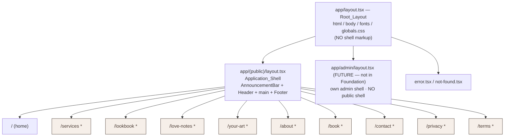
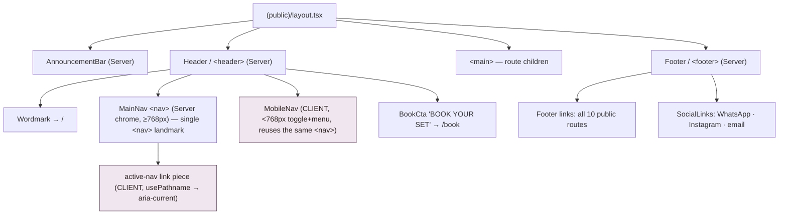

# Design Document

## Overview

This design describes the **Foundation** for the Nail Up website — the technical base and visual
design system that every later feature spec builds upon. Nail Up is a premium nail extension and
nail art studio in Brampton, Ontario, Canada, and the public site must read as a *luxury fashion
editorial × premium beauty campaign* — the "Editorial Beauty Experience" — rather than a generic
salon template.

### What this feature delivers

- A correctly initialised **Next.js (App Router) + React + TypeScript (strict)** project with
  Tailwind CSS, ESLint, path aliases, `.env.example`, `.gitignore`, and a README — scaffolded
  **into the existing workspace root** (no nested `nail-up/` directory), preserving the existing
  `.git/`, `.kiro/`, `docs/`, and the existing `README.md` (which is extended, not overwritten).
- A **scalable architecture** with clear separation of concerns (routes, UI components, layout
  components, data-access, validation, services, shared types, tests, static assets) and a
  documented responsibility for each top-level directory.
- The **Design_System** — the Editorial Beauty Experience expressed as reusable Design_Tokens
  (colours, typography, spacing, container widths, borders, shadows, radii, buttons, interactive
  states, breakpoints) using Tailwind v4's CSS-first `@theme` approach, with no magic values.
- The **Application_Shell** — a root layout plus announcement bar, header/navigation, wordmark,
  primary CTA, footer, WhatsApp shortcut, Instagram link, email link, and a reusable page
  container — wrapping public routes only, driven by a single typed **Business_Config**.
- **Public route placeholders** so all ten public routes resolve without a 404, with deferred
  pages rendering a clearly-marked "coming soon" placeholder.
- **Engineering-quality guardrails** (Server Components by default, strict typing, semantic
  landmarks, responsive verification, reduced-motion handling, environment discipline, visible
  focus) targeting WCAG 2.2 AA where feasible.
- **Testing infrastructure** — Vitest + React Testing Library with at least one passing test, plus
  the typecheck / lint / build verification commands.

### What this feature explicitly defers

The Foundation provides routing and shell only. The following are **out of scope** and belong to
their own specs:

- Appointment **booking** flow and booking rules (`/book` renders a placeholder only).
- **Supabase** database implementation, migrations, RLS policies, and runtime data access. No
  Supabase client is wired up here; only the env-var placeholders exist.
- **Admin dashboard** and all admin functionality. The architecture reserves a boundary *outside*
  the public shell for future admin routes, but no admin route or logic is implemented now.
- **Artwork upload** ("Your Art") processing and moderation (`/your-art` renders a placeholder).
- **Public page content** for `/services`, `/lookbook`, `/love-notes`, `/your-art`, `/about`,
  `/book`, `/contact`, `/privacy`, and `/terms` — content arrives in later specs.
- **End-to-end (Playwright)** test suites — only Vitest unit/integration infrastructure is set up.

---

## Technology & Versions

The stack follows `tech.md`. Versions below reflect the current stable lines verified at the time of
writing; the **exact** patch version is pinned at install time (see version policy).

| Concern | Choice | Current stable line (verify at install) |
| --- | --- | --- |
| Framework | Next.js (App Router) | 16.x (latest ~16.3.x) |
| UI runtime | React | 19.x |
| Language | TypeScript (strict) | 5.x |
| Styling | Tailwind CSS (CSS-first, `@theme`) | v4.x |
| Tailwind build | `@tailwindcss/postcss` PostCSS plugin | v4.x |
| UI primitives | shadcn/ui (added as needed) | current |
| Icons | Lucide React | current |
| Animation | Motion for React (selective, later) | current |
| Validation | Zod | current |
| Unit testing | Vitest + React Testing Library | latest |
| Supabase auth (later) | `@supabase/ssr` (out of scope here) | current |
| Deploy | Vercel + GitHub | — |

### Scaffolding (scaffold-into-existing-workspace via temp dir + merge)

**Verified design decision.** The Nail Up workspace **already exists** and contains project history
and documentation that must be preserved: `.git/`, `.kiro/` (incl. `.kiro/steering/`), `docs/`, and
`README.md`. The Foundation scaffolds the Next.js app **into this existing workspace root** — it does
**NOT** create a nested `nail-up/` directory, and it does **NOT** overwrite the existing project
documentation.

`create-next-app` refuses to initialise a **non-empty** directory, so it cannot be pointed at the
existing workspace root directly. The verified approach is therefore **scaffold into a temporary
directory, then merge only the necessary application scaffold files** into the existing workspace:

1. Run `create-next-app` targeting a **temporary** directory (outside the workspace root), using the
   App Router, TypeScript, Tailwind, ESLint, the `src`-less `app/` layout, and the `@/*` import
   alias:

   ```
   npx create-next-app@latest <temp-dir> \
     --typescript --tailwind --eslint --app --no-src-dir --import-alias "@/*"
   ```

2. **Merge only the necessary application scaffold files** from the temp directory into the existing
   workspace root — e.g. `app/`, `package.json`, `tsconfig.json`, `next.config.ts`,
   `postcss.config.mjs`, `eslint.config.mjs`, `app/globals.css`, and the other generated config
   files. The Next.js project thus lives at the workspace root alongside the pre-existing
   documentation.

3. **Preserve existing files — never clobber them:**
   - `.git/` — existing Git history is kept (the scaffold does not re-init or discard it).
   - `.kiro/` (incl. `.kiro/steering/`) — kept as-is.
   - `docs/` — kept as-is.
   - `README.md` — the existing README is **updated/extended** (the Foundation's README content is
     merged into it), **not** overwritten or replaced wholesale.
   - `.gitignore` — the generated ignore rules are **merged** into the existing `.gitignore` (added
     where missing), **not** clobbered.

`create-next-app` on the Next 16 line provisions Tailwind v4 (CSS-first). After the merge, the
project is adjusted to the directory structure and token architecture described below. The temporary
directory is discarded once its needed files have been merged.

### Version-pinning policy & verified compatibility (Requirement 1.8)

- Every dependency entry in `package.json` is a **pinned exact version** — no `^`, no `~`, no range
  specifiers of any kind. This **pin-exact policy** is retained.
- All selected package versions **and scripts** are **verified against current official
  documentation at install time** before being pinned; exact dependency versions are maintained
  thereafter.
- No deprecated APIs (e.g. `@supabase/auth-helpers` is forbidden; `@supabase/ssr` is used later).
- No unnecessary packages are added.

**Verified compatibility facts (confirmed against current official documentation):**

- **Next.js 16.x App Router** is the current line.
- **Tailwind v4** is **CSS-first** — there is **no `tailwind.config.js`** (tokens live in the
  `@theme` block in `app/globals.css`).
- **ESLint 9+ flat config** (`eslint.config.mjs`) with `eslint-config-next`.
- **`next lint` was removed in Next.js 16** (linting runs via the ESLint CLI, `eslint .`, as a
  separate step — see Testing Strategy → Verification commands).

> **Tailwind v4 note:** Tailwind v4 uses **CSS-first configuration**. There is **no
> `tailwind.config.js`** by default. Tailwind is enabled by `@import "tailwindcss";` in the global
> stylesheet and the `@tailwindcss/postcss` plugin in `postcss.config.mjs`; design tokens are
> declared in CSS via the `@theme` directive (see Design System Architecture). The design
> deliberately follows this v4 model rather than the legacy v3 JS-config model.

---

## Architecture

This section covers the project structure, directory responsibilities, and the Root_Layout vs
`(public)` layout boundary that underpins admin segregation.

### Directory tree

This is the **target/intended** structure at the **existing workspace root** (not a nested
`nail-up/` directory). It documents each directory's responsibility; it is **not** a mandate to
pre-create empty folders — directories are created only when their first real implementation file is
added (see the "No speculative directories" note below). Pre-existing entries (`.git/`, `.kiro/`,
`docs/`, `README.md`, `.gitignore`) are **preserved** and merged, not recreated.

```
<workspace root>/            # existing Nail Up workspace (NOT a nested nail-up/ folder)
├─ .git/                        # EXISTING — preserved (Git history kept).
├─ .kiro/                       # EXISTING — preserved (incl. .kiro/steering/).
├─ docs/                        # EXISTING — preserved (ASSUMPTIONS / IMAGE_MANIFEST / ROADMAP).
├─ app/
│  ├─ layout.tsx                 # Root_Layout: <html>/<body>, fonts, global CSS, metadata.
│  │                             #   Minimal structural wrapper — NO shell markup here.
│  ├─ globals.css                # @import "tailwindcss"; @theme tokens; base styles; breakpoints.
│  ├─ error.tsx                  # App-level error boundary (Client Component).
│  ├─ not-found.tsx              # App-level 404 page.
│  ├─ (public)/                  # PUBLIC route group — carries the Application_Shell.
│  │  ├─ layout.tsx              # Public layout: AnnouncementBar + Header + <main> + Footer.
│  │  ├─ page.tsx                # /            (home)
│  │  ├─ services/page.tsx       # /services    (placeholder)
│  │  ├─ lookbook/page.tsx       # /lookbook    (placeholder)
│  │  ├─ love-notes/page.tsx     # /love-notes  (placeholder)
│  │  ├─ your-art/page.tsx       # /your-art    (placeholder)
│  │  ├─ about/page.tsx          # /about       (placeholder)
│  │  ├─ book/page.tsx           # /book        (placeholder)
│  │  ├─ contact/page.tsx        # /contact     (placeholder)
│  │  ├─ privacy/page.tsx        # /privacy     (placeholder)
│  │  └─ terms/page.tsx          # /terms       (placeholder)
│  └─ (ADMIN BOUNDARY — not implemented in Foundation)
│     # Future admin routes live OUTSIDE (public), e.g. app/admin/ with its OWN
│     # app/admin/layout.tsx, so the announcement bar / nav / footer never render in admin.
│
├─ components/
│  ├─ ui/                        # shadcn/ui primitives (added as needed).
│  └─ layout/                    # Application_Shell pieces (see Application Shell Components).
│     ├─ announcement-bar.tsx
│     ├─ header.tsx
│     ├─ wordmark.tsx
│     ├─ main-nav.tsx            # desktop inline nav chrome (Server); single <nav> landmark.
│     ├─ nav-link.tsx            # "use client" active-nav link: usePathname() → aria-current.
│     ├─ mobile-nav.tsx          # "use client" toggle + menu (one of two Client Components).
│     ├─ book-cta.tsx
│     ├─ footer.tsx
│     ├─ social-links.tsx        # WhatsApp + Instagram + email.
│     ├─ page-container.tsx      # reusable container using container-width tokens.
│     └─ placeholder-page.tsx    # shared "coming soon" placeholder.
│
├─ lib/
│  ├─ config/
│  │  └─ business.ts             # Business_Config: confirmed facts + brand copy (typed).
│  ├─ data-access/               # (reserved seam) server data-access modules — responsibility
│  │                             #   documented; folder created WHEN its first module is added.
│  ├─ validation/                # Zod schemas (reserved seam) — created with first schema module.
│  ├─ services/                  # server business logic (reserved seam) — created with first module.
│  └─ utils/                     # small shared helpers (e.g. cn() class merge).
│
├─ types/                        # shared TypeScript type definitions.
│  └─ business.ts                # types for Business_Config / confirmed vs unconfirmed facts.
│
├─ public/
│  └─ images/                    # per IMAGE_MANIFEST.md
│     ├─ hero/
│     ├─ services/
│     ├─ lookbook/
│     ├─ artist/
│     ├─ clients/
│     └─ branding/
│
├─ tests/                        # single top-level tests directory (Vitest).
│  ├─ setup.ts                   # RTL/jsdom setup.
│  ├─ business-config.test.ts
│  ├─ page-container.test.tsx
│  └─ footer.test.tsx
│
├─ .env.example                  # placeholder env keys only (no secrets).
├─ .gitignore                    # EXISTING — generated ignore rules MERGED in (not clobbered).
├─ eslint.config.mjs             # ESLint 9+ flat config with eslint-config-next.
├─ postcss.config.mjs            # @tailwindcss/postcss
├─ tsconfig.json                 # strict mode; @/* path alias.
├─ vitest.config.ts
├─ next.config.ts
├─ package.json                  # exact pinned versions only; lint script = "eslint ."
└─ README.md                     # EXISTING — updated/extended (not overwritten wholesale).
```

> **No speculative directories (Requirement 2.8 / 2.10).** The tree above is the **target/intended**
> structure with each directory's responsibility documented — it is **not** a mandate to scaffold
> empty folders. **Empty or placeholder directories are explicitly avoided.** A directory is created
> **only when its first real implementation file is needed**; until then, the README/architecture
> note documents its intended responsibility.
>
> This applies directly to `lib/data-access`, `lib/validation`, and `lib/services`: these are the
> *documented seams* required by Requirement 2.4, but they are **created WHEN their first module is
> added** — **not** pre-created empty. The **documented-responsibility contract** (in the
> README/architecture note) is what satisfies Requirement 2; an empty placeholder folder is **not**
> required and is deliberately not created. This keeps the design consistent with Requirements 2.8 /
> 2.10 (no speculative/empty directories) while still establishing the separation-of-concerns seams
> that later specs drop their modules into.

### Responsibility of each top-level directory (Requirement 2.9)

- **`app/`** — App Router routes and layouts. Holds the Root_Layout, the `(public)` route group and
  its shell layout, the ten public route pages, and app-level `error.tsx` / `not-found.tsx`.
- **`components/`** — reusable UI. `components/ui/` holds shadcn/ui primitives; `components/layout/`
  holds the Application_Shell structural components and shared page primitives.
- **`lib/`** — non-UI logic, split into `config/` (Business_Config), `data-access/` (server data
  access — reserved seam), `validation/` (Zod schemas — reserved seam), `services/` (server business
  rules — reserved seam), and `utils/` (small shared helpers). The reserved-seam folders
  (`data-access/`, `validation/`, `services/`) are **created when their first module is added**, not
  pre-created empty; their responsibilities are documented in the README/architecture note.
- **`types/`** — shared TypeScript type definitions used across the app, kept separate from runtime
  modules (Requirement 2.5).
- **`public/`** — static assets served as-is, including `public/images/` with the manifest folders.
- **`tests/`** — the single top-level location for Vitest unit/integration tests and setup
  (Requirement 2.7).

### Root_Layout vs (public) layout boundary (Requirements 2.1, 2.11, 4.1)

The shell boundary is the critical architectural decision of this Foundation:

- **`app/layout.tsx` (Root_Layout)** is intentionally *minimal and shell-free*. It renders only the
  `<html>`/`<body>` shell, loads fonts via `next/font`, imports `globals.css`, and sets base
  metadata. It applies to **every** route in the app — public and (future) admin alike — so it must
  contain **no** announcement bar, navigation, or footer.
- **`app/(public)/layout.tsx`** is where the **Application_Shell** is applied. It renders the
  AnnouncementBar, Header (nav + wordmark + CTA), the single `<main>` landmark, and the Footer
  around its route children. Because it lives inside the `(public)` route group, it wraps **only**
  the public routes.
- Future **admin** routes (e.g. `app/admin/...`) live **outside** `(public)` and bring their **own**
  `app/admin/layout.tsx`. They inherit the minimal Root_Layout but **not** the public shell — so the
  announcement bar, public nav, and footer never render inside the admin dashboard. No admin route
  or functionality is implemented in the Foundation; only this structural separation is established.

The `(public)` group adds the shell without adding a URL segment, so routes remain `/`, `/services`,
etc.

### Route & layout structure



`*` = placeholder page in the Foundation (resolves without 404; content deferred).

---

## Design System Architecture (Editorial Beauty Experience)

The Design_System is defined **CSS-first** per Tailwind v4. `app/globals.css` begins with
`@import "tailwindcss";` and declares tokens inside an `@theme` block. Tokens declared in `@theme`
are emitted by Tailwind as CSS custom properties **and** as corresponding Tailwind utilities, which
satisfies Requirement 3.2 (each colour token resolves to the same value as both a CSS variable and a
Tailwind theme token) automatically — a single declaration produces `--color-ivory` *and* utilities
like `bg-ivory`/`text-ivory`.

```css
/* app/globals.css (illustrative — hex finalised at implementation) */
@import "tailwindcss";

@theme {
  /* ── Brand palette: EXACTLY EIGHT colour tokens (Requirement 3.1) ── */
  --color-ivory:    #f7f1e8; /* warm ivory   — background / canvas */
  --color-cream:    #fbf6ef; /* milky cream  — background / canvas */
  --color-rose:     #c99aa0; /* dusty rose   — accent */
  --color-blush:    #e8d2d1; /* muted blush  — accent */
  --color-espresso: #2c211c; /* deep espresso— primary text / dark surface */
  --color-plum:     #6b4a63; /* soft plum    — secondary accent */
  --color-champagne:#e6d4ad; /* champagne    — highlight */
  --color-chrome:   #c7c9cc; /* chrome/silver— metallic highlight */

  /* ── Semantic tokens (Requirement 3.11 — NOT part of the eight brand colours) ── */
  --color-success: #3f7d58;
  --color-error:   #a63d4a;
  --color-warning: #b5832e;
  --color-focus:   #6b4a63; /* focus-visible ring colour (accessibility) */

  /* ── Typography (Requirement 3.3, 3.4) ── */
  --font-serif: var(--font-headline), Georgia, "Times New Roman", serif; /* headline */
  --font-sans:  var(--font-body), ui-sans-serif, system-ui, sans-serif;  /* body */
  /* editorial label token values (applied via utility/component, see note) */
  --tracking-label: 0.18em;      /* positive letter-spacing */

  /* ── Spacing scale: ≥5 strictly increasing steps (Requirement 3.5) ── */
  --spacing-xs: 0.5rem;   /*  8px */
  --spacing-sm: 1rem;     /* 16px */
  --spacing-md: 1.5rem;   /* 24px */
  --spacing-lg: 2.5rem;   /* 40px */
  --spacing-xl: 4rem;     /* 64px */
  --spacing-2xl: 6rem;    /* 96px */

  /* ── Container widths (Requirement 3.6) ── */
  --container-content: 72rem;  /* standard page content width (1152px) */
  --container-narrow:  48rem;  /* narrow reading column */
  --container-wide:    90rem;  /* editorial wide / hero (1440px) */

  /* ── Borders / shadows / radii (Requirement 3.7) ── */
  --border-hairline: 1px;                 /* restrained editorial border width */
  --color-border:    #e6ddd1;             /* hairline border colour */
  --radius-sm: 0.25rem;
  --radius-md: 0.5rem;                    /* restrained — avoid excessive rounding */
  --shadow-soft: 0 12px 40px -12px rgba(44, 33, 28, 0.18);

  /* ── Responsive breakpoints (Requirement 3.10) ── */
  --breakpoint-md: 768px;
  --breakpoint-lg: 1024px;
  --breakpoint-xl: 1280px;
  --breakpoint-2xl: 1440px;
}
```

### Typography tokens (Requirements 3.3, 3.4)

- A **serif headline** family and a **sans-serif body** family, loaded via `next/font` in the
  Root_Layout and exposed as CSS variables (`--font-headline`, `--font-body`) that the `@theme`
  `--font-serif` / `--font-sans` tokens reference. The two families are visually distinct.
- An **uppercase editorial label** token: a small reusable primitive (utility class or
  `.editorial-label` component) that applies `text-transform: uppercase` and the positive
  `--tracking-label` letter-spacing. Because Tailwind v4 cannot express a compound text-transform +
  tracking value as a single `@theme` colour/size token, the label is implemented as a small
  token-backed utility that reads `--tracking-label` — it still sources its spacing value from a
  Design_Token, not a literal.

### Buttons & interactive states (Requirements 3.8, 3.9)

- **Primary button** and **secondary button** tokens produce two **visually distinct** styles — e.g.
  primary = solid `--color-espresso` background with `--color-ivory` text; secondary = transparent
  background with a `--border-hairline` `--color-espresso` outline and espresso text. These are
  defined as token-backed button variants (consumed by the shadcn `Button` later) so both draw from
  Design_Tokens.
- **Hover** state token: a defined hover treatment (e.g. background/opacity shift toward
  `--color-plum`/`--color-rose`) distinct from the default.
- **Focus-visible** indicator token: a visible ring using `--color-focus` and a defined offset,
  applied via `:focus-visible`. It is distinguishable from **both** the default state (no ring) and
  the hover state (colour shift, no ring) — satisfying Requirement 3.9 / 5.15.

### Responsive system (Requirement 3.10)

- **Mobile-first.** Base styles target widths **below 768 px**; progressive overrides apply at the
  declared CSS_Breakpoint_System values **768 / 1024 / 1280 / 1440 px** via the `--breakpoint-*`
  tokens (Tailwind v4 generates `md:` / `lg:` / `xl:` / `2xl:` variants from these).
- The eight **Viewport_Set** verification widths are **375 / 390 / 430 / 768 / 1024 / 1280 / 1440 /
  1920 px**. These are the widths at which layouts are *verified*; 375/390/430/1920 are testing
  viewports, not additional mandatory CSS breakpoints.

### Token-enforcement rule (Requirements 3.12, 3.13, 3.14)

- A reusable Design_Token is **required** for every meaningful design-system value: colours, spacing,
  typography, radii, borders, shadows, and breakpoints. Components must source these from tokens
  (CSS variables / Tailwind theme utilities) — **no hard-coded magic values**.
- **Permitted literals:** structural/primitive values such as `0`, `100%`, and a basic `1px` border
  width may appear as literals without a token.
- Using a meaningful design-system value hard-coded as a literal (e.g. `#c99aa0`, `margin: 37px`)
  instead of a token renders the Foundation **non-compliant**, except for the permitted primitives.

---

## Components and Interfaces

This section defines the Application_Shell components, their Server/Client boundary, their
responsibilities and prop/data interfaces, and the public route placeholder components.

### Application Shell Components

All shell components are **Server Components** except where genuine interactivity is required. There
are **two** small Client Components in the Foundation: the **mobile navigation** (toggle + menu) and
the **active-nav link** piece (which calls `usePathname()` to resolve the active route — see
Active-route indicator below). Both client boundaries are kept **minimal**; everything else in the
shell remains a Server Component. Every business fact and brand string is read from
**Business_Config** — no shell component hard-codes a duplicate literal of those values
(Requirement 4.13).

### Business_Config module (Requirement 4.13, 1.15, product.md)

`lib/config/business.ts` is the single typed source of **confirmed** facts and brand copy. Confirmed
facts, verbatim from `product.md` (these are final — never substituted):

| Key | Value (verbatim) |
| --- | --- |
| Business name | `Nail Up` |
| Business type | `Nail Extension Artist & Nail Art Studio` |
| Location | `Brampton, Ontario, Canada` |
| WhatsApp number | `+1-6473347600` |
| WhatsApp URL | `https://wa.me/16473347600` |
| Instagram URL | `https://www.instagram.com/nailup_/` |
| Business email | `prabhvirdi3011@gmail.com` |
| Booking route | `/book` |
| Currency | `CAD` |
| Timezone | `America/Toronto` |
| Language | `English (Canadian spelling)` |

Confirmed brand copy, verbatim:

- Tagline: `Nails, but make them art.`
- Homepage headline: `Your nails. Your canvas.`
- Supporting statement: `Luxury nail extensions and custom nail artistry, designed around your style.`
- Default announcement bar: `Brampton, your next nail obsession starts here. ✦ Book your set.`
- Primary CTA: `BOOK YOUR SET`
- Secondary CTA: `EXPLORE THE LOOKBOOK`
- Community CTA: `SHARE YOUR NAIL INSPIRATION`
- Your Art heading: `Your Idea. Our Canvas.`
- Your Art supporting text: `Found a nail design you love? Share it with Nail Up and let's make your next set personal.`

The module also holds the ordered **navigation route list** (nav + footer order) so paths are not
duplicated across components:

- Nav order (Requirement 4.4): `/`, `/services`, `/lookbook`, `/love-notes`, `/your-art`, `/about`,
  `/book`, `/contact`.
- Footer adds (Requirement 4.9): `/privacy`, `/terms`.

`Business_Config` is typed via `types/business.ts`. It is a plain typed TS module (no secrets, no
env) so it is safe for both Server and Client components.

### Unconfirmed_Fact handling (Requirements 4.15, 1.15, product.md "Do NOT invent")

Unknown facts — **street address, opening hours, service prices, durations, artist name/bio/awards,
genuine testimonials/ratings** — are **never fabricated**. A typed `UnconfirmedFact` representation
carries an explicit "awaiting business confirmation" status. Any shell surface that *would* show
such a value either **omits it entirely** or renders a placeholder whose **visible text contains
"awaiting business confirmation"** — never a fabricated substitute. In the Foundation shell the
footer deliberately **omits** address/hours rather than inventing them.

### Shell component catalogue

| Component | Server/Client | Responsibility | Data / props |
| --- | --- | --- | --- |
| **AnnouncementBar** | Server | Renders the announcement strip with copy from Business_Config, defaulting to the exact announcement text. | reads `businessConfig.copy.announcement` (Req 4.2) |
| **Header / Navbar** | Server wrapper | Semantic `<header>` landmark containing Wordmark, MainNav (desktop), MobileNav (mobile), and the BOOK YOUR SET CTA. Exactly one `<header>` and one `<nav>`. | composes children |
| **Wordmark** | Server | "Nail Up" wordmark linking to `/`. | `businessConfig.name`, route `/` (Req 4.3) |
| **MainNav** | Server wrapper + minimal Client link piece | Inline nav links at ≥768px, one per public route in order. The static chrome stays a Server Component; the **active-route indicator** is applied by a **minimal Client Component** (`nav-link.tsx` / a small `main-nav` client wrapper) that calls `usePathname()` from `next/navigation` to set `aria-current="page"` and the active visual treatment. Rendered inline, hidden below 768px via responsive tokens. | nav list from Business_Config (Req 4.4, 4.5, 4.7) |
| **MobileNav** | **Client** (`"use client"`) | Below 768px: hides inline links, renders a single visible toggle control that opens a menu exposing all public-route links; manages open/close state and focus; respects `prefers-reduced-motion`. One of the two small Client Components. | nav list from Business_Config (Req 4.6) |
| **BookCta** | Server | Primary button labelled exactly "BOOK YOUR SET" linking to `/book`. | `businessConfig.copy.primaryCta`, booking route (Req 4.8) |
| **Footer** | Server | Semantic `<footer>` landmark with one link to **each** public route incl. `/privacy` and `/terms`, plus SocialLinks. Omits unconfirmed facts. | footer route list + SocialLinks (Req 4.9) |
| **SocialLinks** | Server | WhatsApp link → `https://wa.me/16473347600` (new context, accessible label); Instagram link → `https://www.instagram.com/nailup_/` (no query/tracking params, new context, accessible label); email link → `mailto:prabhvirdi3011@gmail.com`. | Business_Config (Req 4.10–4.12) |
| **PageContainer** | Server | Reusable container applying `--container-*` width tokens; all width/spacing/layout values from Design_Tokens. Used by shell and pages. | `width` variant prop, children (Req 4.14) |
| **PlaceholderPage** | Server | Shared "coming soon" placeholder primitive for deferred routes. | `title`, `description` props |

### Active-route indicator (Requirement 4.5)

**Verified design decision.** The active navigation route is resolved by a **small Client Component**
(e.g. `nav-link.tsx`, or a minimal `main-nav` client wrapper) that calls **`usePathname()`** from
`next/navigation`. That component compares the current pathname to each link's path and applies
`aria-current="page"` plus the token-based active visual treatment (e.g. an underline/weight shift
using Design_Tokens) to the matching link.

Two constraints are **critical**:

- **Exactly one `<nav>` landmark.** The active-nav client piece renders links **inside** the single
  semantic `<nav>` landmark; it does **not** introduce a second `<nav>`. Together with the mobile
  menu (which reuses the same single `<nav>`), there remains exactly one `<nav>` in the public shell.
- **Minimal Client Component boundary.** Only the active-state logic / link list is a Client
  Component (because `usePathname()` is a client hook). The surrounding static chrome
  (`<nav>`/`<header>` structure, wordmark, CTA) stays a **Server Component** wherever practical, so
  client JS is kept to the minimum needed to compute the active route. This preserves the
  "minimal client JS" principle.

### Links & new browsing contexts (Requirements 4.10, 4.11)

External links (WhatsApp, Instagram) open in a new browsing context (`target="_blank"` with
`rel="noopener noreferrer"`) and carry explicit accessible labels identifying them ("Nail Up on
WhatsApp", "Nail Up on Instagram"). The Instagram URL is stored and rendered **exactly** as
`https://www.instagram.com/nailup_/` with **no** query string or tracking parameters.

### Shell component hierarchy



---

### Public Route Placeholders

All ten public routes resolve to a rendered page so none returns a 404 (Requirements 4.16, 4.17).
Deferred routes render a **minimal, clearly-marked placeholder** with **no business functionality**.

- Each deferred route's `page.tsx` renders a shared **`PlaceholderPage`** component inside a
  `PageContainer`. `PlaceholderPage` shows an editorial-styled heading and a short line that clearly
  marks the page as a placeholder / coming soon (e.g. "This page is coming soon.").
- The placeholder uses only confirmed copy/tokens; it never fabricates prices, hours, bios, etc. If
  a page would otherwise surface an Unconfirmed_Fact, it follows the Unconfirmed_Fact pattern.
- `/` (home) may render a light editorial landing using confirmed copy (headline "Your nails. Your
  canvas.", supporting statement, primary + secondary CTAs) — still within Foundation scope (shell +
  confirmed copy only), with richer content deferred.
- `/privacy` and `/terms` resolve to placeholders too (they are reachable from the footer).

Each placeholder page sets per-route `metadata` (title/description) using confirmed copy so routing
and SEO basics work, without implementing the deferred business features.

---

## Data Models

The Foundation has **no database and no runtime data access** (Supabase is deferred). The only data
in scope are the in-code, typed configuration structures that the Application_Shell reads from. These
are defined in `types/business.ts` and populated in `lib/config/business.ts`.

### Business configuration types

These interfaces are illustrative; final shapes are confirmed at implementation. Values marked
confirmed come verbatim from `product.md`.

```ts
// types/business.ts

/** A public route the shell links to. */
export interface PublicRoute {
  readonly path: string;        // e.g. "/services"
  readonly label: string;       // nav/footer display label (English Canadian spelling)
  readonly inPrimaryNav: boolean; // true for the 8 nav routes; false for /privacy, /terms
}

/** Confirmed, final business facts — never substituted. */
export interface BusinessFacts {
  readonly name: string;                 // "Nail Up"
  readonly type: string;                 // "Nail Extension Artist & Nail Art Studio"
  readonly location: string;             // "Brampton, Ontario, Canada"
  readonly whatsappNumber: string;       // "+1-6473347600"
  readonly whatsappUrl: string;          // "https://wa.me/16473347600"
  readonly instagramUrl: string;         // "https://www.instagram.com/nailup_/" (no params)
  readonly email: string;                // "prabhvirdi3011@gmail.com"
  readonly bookingRoute: string;         // "/book"
  readonly currency: "CAD";
  readonly timezone: "America/Toronto";
}

/** Confirmed brand copy — verbatim from product.md. */
export interface BrandCopy {
  readonly tagline: string;
  readonly homepageHeadline: string;
  readonly supportingStatement: string;
  readonly announcement: string;         // default announcement-bar text
  readonly primaryCta: string;           // "BOOK YOUR SET"
  readonly secondaryCta: string;         // "EXPLORE THE LOOKBOOK"
  readonly communityCta: string;
  readonly yourArtHeading: string;
  readonly yourArtSupporting: string;
}

/**
 * A business detail that is unknown until the owner confirms it. Never fabricated.
 * Rendered either omitted, or with visible text containing "awaiting business confirmation".
 */
export interface UnconfirmedFact {
  readonly key:
    | "streetAddress"
    | "openingHours"
    | "prices"
    | "durations"
    | "artistBio"
    | "testimonials";
  readonly status: "awaiting-business-confirmation";
}

export interface BusinessConfig {
  readonly facts: BusinessFacts;
  readonly copy: BrandCopy;
  readonly routes: readonly PublicRoute[]; // ordered: nav routes first, then /privacy, /terms
}
```

### Design-token model

Design_Tokens are **not** TypeScript data structures; they are declared as CSS custom properties
inside the Tailwind v4 `@theme` block in `app/globals.css` (see Design System Architecture). Each
token has a single canonical declaration that Tailwind emits as both a CSS variable and a utility,
so there is no separate token data model to maintain in TypeScript.

---

## Engineering Quality & Accessibility

- **Server Components by default (Requirements 5.1–5.3).** Everything is a Server Component unless it
  needs genuine browser interactivity. The Foundation has **two** small Client Components: `MobileNav`
  (the menu toggle) and the **active-nav link** piece (which needs `usePathname()` from
  `next/navigation`). Non-interactive components are never marked `"use client"`; `"use client"`
  scope is kept minimal (the mobile menu, and the active-link logic — not the surrounding static
  chrome).
- **Strict TypeScript (Requirements 5.4, 5.5, 1.3).** `strict: true`. `any` is avoided; any
  unavoidable `any` carries a justifying comment. Types for Business_Config live in `types/`.
- **Semantic landmarks (Requirement 5.6).** The public shell renders **exactly one** each of
  `<header>`, `<nav>`, `<main>`, and `<footer>`. Both the mobile menu and the active-nav link piece
  render their links **inside** the single `<nav>` — neither introduces a second `<nav>` landmark, so
  there remains **exactly one** semantic `<nav>`.
- **Responsive verification (Requirements 5.7, 3.10).** The shell is verified at all eight
  Viewport_Set widths (375/390/430/768/1024/1280/1440/1920) for no horizontal scrolling and no
  overlapping/clipped interactive elements. This is a QA checklist item for the shell build task.
- **Reduced motion (Requirement 5.8).** A global `@media (prefers-reduced-motion: reduce)` rule
  disables non-essential transitions/animations. Motion for React is introduced **selectively and
  later**; when used it must respect `prefers-reduced-motion` (disable non-essential motion) and
  never block interaction or harm mobile scrolling. The Foundation's only motion (if any) is the
  mobile menu transition, which is disabled under reduced motion.
- **Environment discipline (Requirements 5.9–5.11, security.md).** Only genuinely public values use
  the `NEXT_PUBLIC_` prefix (`NEXT_PUBLIC_SUPABASE_URL`, `NEXT_PUBLIC_SUPABASE_ANON_KEY`,
  `NEXT_PUBLIC_SITE_URL`). Privileged values (`SUPABASE_SERVICE_ROLE_KEY`, `RESEND_API_KEY`,
  `EMAIL_FROM`, `EMAIL_BUSINESS_NOTIFICATION`) are server-only, never `NEXT_PUBLIC_`, and never read
  from a Client Component. No real secrets are committed — `.env.example` holds placeholders only.
- **Naming convention (Requirement 5.12).** One consistent convention across the repo: component
  files `kebab-case.tsx` exporting `PascalCase` components; functions/variables `camelCase`; types
  `PascalCase`; route folders lowercase kebab matching the URL. Documented in the README.
- **Empty / error states (Requirements 5.13, 5.14).** Reusable interactive elements render an
  explicit empty state when they have no content, and an error-indicating state (preserving any
  valid content) if they enter an error state. In the Foundation this applies to the nav primitive:
  if given an empty route list it renders nothing harmful / an explicit empty state rather than
  breaking.
- **Visible focus (Requirements 5.15, 4.x).** Every focusable interactive element shows the
  token-based `:focus-visible` indicator, distinguishable from default and hover.
- **Accessibility target.** WCAG 2.2 AA where feasible: keyboard navigation, visible focus,
  screen-reader-friendly semantics, sufficient contrast (final hex chosen to meet AA against their
  intended backgrounds), reduced-motion support, and descriptive `alt` text on all images per the
  manifest. Full AA conformance requires manual assistive-technology testing and expert review,
  which is noted as an ongoing QA activity.

---

## Environment & Configuration

### `.env.example` (placeholders only — Requirements 1.12, 5.9–5.11)

Keys exactly as listed in `tech.md`, with empty/placeholder values and comments; no real values:

```
NEXT_PUBLIC_SUPABASE_URL=
NEXT_PUBLIC_SUPABASE_ANON_KEY=
SUPABASE_SERVICE_ROLE_KEY=        # server-only, never exposed to client
RESEND_API_KEY=                   # server-only
EMAIL_FROM=
EMAIL_BUSINESS_NOTIFICATION=      # where booking/contact notices go
NEXT_PUBLIC_SITE_URL=
```

No Supabase/Resend client is wired up in the Foundation; these keys exist only as the documented
contract for later specs.

### `.gitignore` expectations (Requirement 1.13)

Excludes build artefacts and dependencies (`.next/`, `out/`, `build/`, `node_modules/`), and the
real env files `.env` and `.env.local`, while **retaining** `.env.example` in version control. Also
ignores OS/editor cruft and test coverage output.

### Path aliases (Requirement 1.11)

`tsconfig.json` defines `@/*` → project root (e.g. `@/components/...`, `@/lib/...`, `@/types/...`),
and `strict: true` is enabled. The alias resolves for both the app and tests.

### README contents (Requirements 1.14, 1.15, 2.9)

The README documents:

- **Project purpose** — the Nail Up public site Foundation.
- **Prerequisites** — Node version, package manager.
- **Setup steps** — clone, install, copy `.env.example` → `.env.local`, run dev.
- **Runnable commands** — `dev`, `build`, `start`, `lint` (`eslint .` — a **separate** step, since
  Next 16 removed `next lint` and `next build` no longer lints), `typecheck`, `test` (Vitest
  `--run`).
- **Conventions** — English Canadian spelling in user-facing copy; Server Components by default; the
  naming convention; the token/no-magic-values rule.
- **Architecture note** — the responsibility of each top-level directory (satisfying Requirement 2.9
  / 2.10), and the Root_Layout vs `(public)` shell boundary with the reserved admin boundary.

---

## Testing Strategy

**Property-based testing (PBT) does not apply to this Foundation feature.** The deliverables are
project configuration, directory structure, a CSS-first design-token system, UI shell components,
and placeholder pages. Per `testing.md` and the PBT guidance, these fall into the categories where
PBT is *not* appropriate: UI rendering/layout (snapshot/example tests), configuration/setup (smoke
checks via build/lint/typecheck), and simple value exposure (example-based assertions). There are no
pure algorithmic functions, parsers, serializers, or transformations with universal
"for all inputs" properties in this scope. The Correctness Properties section is therefore
**omitted**, and the strategy below uses example-based unit tests plus the build/verification
commands. Property-based testing will be introduced in later specs that contain real business logic
(booking rules, validation, filename generation) as directed by `testing.md`.

### Framework (Requirements 6.5, 6.7)

- **Vitest** + **React Testing Library** (with `jsdom`), configured in `vitest.config.ts` with a
  `tests/setup.ts`. Vitest supports single-execution **`--run`** mode, which the agent/CI uses
  (never watch mode).

### Initial tests (Requirement 6.6 — at least one passing test)

1. **Business_Config values** — asserts the confirmed facts/copy are present and exact (WhatsApp URL
   `https://wa.me/16473347600`, Instagram `https://www.instagram.com/nailup_/` with no params, email
   `prabhvirdi3011@gmail.com`, announcement default text, primary CTA `BOOK YOUR SET`, and the nav
   route order). This guards against accidental fabrication/typos of confirmed facts.
2. **Shell component render** — renders the `Footer` and asserts it links to all ten public routes
   (incl. `/privacy`, `/terms`) and the WhatsApp/Instagram/email links with correct `href` and
   accessible labels.
3. **PageContainer** — renders children and asserts it applies a container-width token class (not a
   hard-coded width).

### Verification commands (Requirements 1.4–1.7, 6.1–6.4, 6.8–6.10)

| Purpose | Command |
| --- | --- |
| Typecheck | `tsc --noEmit` (zero errors; non-zero exit on error) |
| Lint | `eslint .` (zero violations; non-zero exit on violation) — the ESLint CLI, run as a **separate** step |
| Unit tests | `vitest --run` (single execution; initial tests pass) |
| Production build | `next build` (succeeds; non-zero exit on failure) — **does not lint** on Next 16 |

All four complete without errors on an error-free Foundation (Requirement 6.10). These are exposed
as `package.json` scripts (`typecheck`, `lint`, `test`, `build`).

> **Next.js 16 linting — verified.** Next.js 16 **removed the `next lint` command entirely**, and
> `next build` **no longer runs linting automatically**. Linting is therefore a **separate
> verification step that must be run on its own** (via its own `lint` script / CI step), because the
> build will no longer surface lint violations. The `package.json` `lint` script is `eslint .` (the
> supported **ESLint CLI**), using **ESLint 9+ flat config** (`eslint.config.mjs`) with
> **`eslint-config-next`**. Every earlier reference to `next lint` is replaced by `eslint .`.
> Verified against the official Next.js 16 upgrade guidance and multiple current sources
> ([Next.js 16 linting setup with ESLint 9 flat config](https://chris.lu/web_development/tutorials/next-js-16-linting-setup-eslint-9-flat-config),
> [Next.js 16 removed `next lint`](https://www.nihardaily.com/posts/nextjs-16-deleted-next-lint-heres-the-fix),
> [Next.js ESLint configuration reference](https://nextjs.org/docs/pages/api-reference/config/eslint)).
> Content was rephrased for compliance with licensing restrictions.

### Out of scope

Playwright end-to-end suites are **not** set up in the Foundation (deferred per requirements and
`testing.md`).

---

## Error Handling

- **App-level error boundary** — `app/error.tsx` (a Client Component, as Next.js requires for error
  boundaries) renders a graceful, token-styled error UI with a reset action, without leaking stack
  details to users.
- **Not-found handling** — `app/not-found.tsx` renders a friendly 404 within the editorial styling
  for any unmatched path. All ten *known* public routes resolve to real pages, so 404 is reserved
  for genuinely unknown paths (Requirement 4.16).
- **Reusable component states (Requirements 5.13, 5.14).** Reusable interactive primitives expose an
  explicit **empty state** when they have no content, and an **error-indicating state** that
  preserves valid content if they fail. In the Foundation this is exercised by the nav/link
  primitives (e.g. an empty route list renders an explicit empty state rather than throwing).
- **Boundary placement.** Error/not-found files are placed at the app boundary so they cover the
  public routes; future admin routes can add their own boundary files under their own layout later.

---

## Design Decisions & Rationale

- **Tailwind v4 CSS-first tokens.** Tailwind v4 removed the default JS config in favour of the
  `@theme` directive. Declaring tokens in `globals.css` emits both CSS variables and matching
  utilities from one source, directly satisfying "same value as CSS variable and Tailwind token"
  (Req 3.2) and the no-magic-values rule, while keeping the design system themeable. This is why the
  design intentionally avoids a legacy `tailwind.config.js`.
- **Route-group layout boundary for admin segregation.** Putting the shell on
  `app/(public)/layout.tsx` (not the root layout) means the announcement bar/nav/footer wrap public
  routes only. Future admin routes live outside `(public)` with their own layout and inherit only
  the minimal root layout — cleanly satisfying Requirements 2.11 / 4.1 without any admin code now.
- **Server-first component strategy.** Server Components by default keep client JS lean and align
  with `tech.md`. Two pieces need the client: `MobileNav` (menu interactivity) and the active-nav
  link piece (`usePathname()` for `aria-current`). Both client boundaries are kept minimal, so the
  rest of the shell ships zero client JS and there remains exactly one `<nav>` landmark.
- **`next/font` for typography.** Loading the serif headline and sans body via `next/font` gives
  self-hosted, layout-shift-free fonts and clean CSS-variable wiring into the `@theme` tokens.
- **Placeholder-page strategy.** A single shared `PlaceholderPage` keeps all ten routes resolvable
  (no 404) with a consistent, clearly-marked "coming soon" state and zero fabricated business
  functionality — satisfying Requirements 4.16 / 4.17 while deferring real content to later specs.
- **Business_Config as a single typed source.** Centralising confirmed facts/copy prevents duplicated
  literals across shell components (Req 4.13) and makes the Unconfirmed_Fact rule enforceable: if a
  fact is not in Business_Config as confirmed, it is either omitted or shown as "awaiting business
  confirmation".
