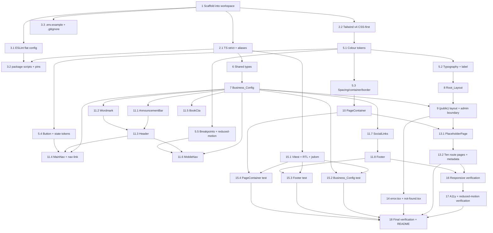

# Implementation Plan: Nail Up Foundation

## Overview

This plan converts the approved Foundation design into incremental coding tasks. Each task builds on
the previous one and ends with everything wired together — no orphaned code. The approach is:
scaffold Next.js **into the existing workspace root** (never a nested `nail-up/` folder) via a temp
dir + merge, lock down configuration, declare the Editorial Beauty Experience design tokens, build
the typed Business_Config, then assemble the Root_Layout → `(public)` shell → shell components →
public route placeholders → error boundaries, add Vitest tests, and finish with full QA +
verification (`typecheck` / `eslint .` / `vitest --run` / `next build`) and the README.

Per the design's Testing Strategy, **property-based testing does not apply** to this Foundation
(config/setup, CSS-first tokens, UI shell, placeholders). Tests here are example-based unit/
integration tests and are marked optional with `*`. Core implementation tasks are never optional.

Scope guardrails baked into every task:
- Preserve existing `.git/`, `.kiro/` (incl. steering), `docs/`; extend (not overwrite) `README.md`; merge `.gitignore`.
- No nested project directory; directories are created only when their first real file is added (no empty/speculative folders).
- Supabase, booking logic, artwork uploads, and admin dashboard are OUT of scope — placeholders and env placeholders only.
- Server Components by default; only `MobileNav` and the active nav-link are Client Components.
- Every verifiable task lists the exact command(s) to run and what to observe.

## Tasks

- [x] 1. Scaffold Next.js into the existing workspace root (temp dir + merge)
  - Run `create-next-app` into a temporary directory OUTSIDE the workspace: `npx create-next-app@latest <temp-dir> --typescript --tailwind --eslint --app --no-src-dir --import-alias "@/*"`.
  - Merge only the necessary scaffold files into the workspace root: `app/`, `app/globals.css`, `package.json`, `tsconfig.json`, `next.config.ts`, `postcss.config.mjs`, `eslint.config.mjs`, and other generated config files.
  - PRESERVE existing files — never clobber: keep `.git/`, `.kiro/`, `docs/` as-is; EXTEND existing `README.md` (do not overwrite); MERGE generated `.gitignore` rules into the existing `.gitignore`.
  - Do NOT create a nested `nail-up/` directory; the app lives at the workspace root. Discard the temp dir after merge.
  - Confirm Next.js 16 App Router + React + TypeScript are present in `package.json`.
  - Acceptance check: run `npm install` then `npm run dev`; observe the dev server starts with no errors and `/` responds. Run `git status` to confirm `.git/`, `.kiro/`, `docs/`, and prior `README.md` content are intact.
  - _Requirements: 1.1, 1.2, 1.3_

- [x] 2. Lock down TypeScript, path aliases, and Tailwind v4 CSS-first setup
  - [x] 2.1 Configure TypeScript strict mode + `@/*` path aliases
    - In `tsconfig.json` set `"strict": true` and define `"paths": { "@/*": ["./*"] }` resolving to the project root for app and tests.
    - Acceptance check: run `npx tsc --noEmit` on the clean project; observe zero type errors and a clean exit. Add a throwaway file importing via `@/` to confirm the alias resolves, then remove it.
    - _Requirements: 1.3, 1.4, 1.11, 5.4_
  - [x] 2.2 Confirm Tailwind v4 CSS-first wiring (no `tailwind.config.js`)
    - Ensure `app/globals.css` begins with `@import "tailwindcss";` and `postcss.config.mjs` uses the `@tailwindcss/postcss` plugin. Ensure NO `tailwind.config.js`/`.ts` exists.
    - Acceptance check: delete any generated `tailwind.config.*` if present; run `npm run dev` and confirm a Tailwind utility class (e.g. `bg-black`) applies to rendered output in the browser.
    - _Requirements: 1.9_

- [x] 3. Configure ESLint flat config, package scripts, env, and gitignore
  - [x] 3.1 ESLint 9+ flat config with `eslint-config-next`
    - Ensure `eslint.config.mjs` (flat config) extends `eslint-config-next`.
    - Acceptance check: run `npx eslint .`; observe zero violations and clean exit on the clean project. Introduce a deliberate violation, confirm non-zero exit, then revert.
    - _Requirements: 1.10, 6.3, 6.4_
  - [x] 3.2 Define `package.json` scripts with pinned exact versions
    - Add scripts: `dev`, `build` (`next build`), `start` (`next start`), `lint` (`eslint .` — NOT `next lint`), `typecheck` (`tsc --noEmit`), `test` (`vitest --run`).
    - Pin EVERY dependency and devDependency to an exact version — remove all `^`/`~`/range specifiers; verify versions against current stable at install time.
    - Acceptance check: run each script (`npm run lint`, `npm run typecheck`, `npm run build`) and confirm they execute; grep `package.json` to confirm no `^`/`~` remain and `lint` is exactly `eslint .`.
    - _Requirements: 1.6, 1.7, 1.8, 1.10, 5.9_
  - [x] 3.3 Create `.env.example` (placeholders only) and merge `.gitignore`
    - Create `.env.example` with placeholder keys ONLY (no secrets): `NEXT_PUBLIC_SUPABASE_URL`, `NEXT_PUBLIC_SUPABASE_ANON_KEY`, `SUPABASE_SERVICE_ROLE_KEY` (server-only comment), `RESEND_API_KEY` (server-only comment), `EMAIL_FROM`, `EMAIL_BUSINESS_NOTIFICATION`, `NEXT_PUBLIC_SITE_URL`.
    - Ensure `.gitignore` excludes `.next/`, `out/`, `build/`, `node_modules/`, `.env`, `.env.local`, coverage, and OS/editor cruft — while RETAINING `.env.example`.
    - Acceptance check: run `git check-ignore -v .env .env.local .next node_modules` (expect ignored) and `git check-ignore .env.example` (expect NOT ignored). Confirm `.env.example` contains no real values.
    - _Requirements: 1.12, 1.13, 5.10, 5.11_

- [x] 4. Checkpoint — project boots and all config verifies
  - Ensure all tests pass, ask the user if questions arise. Run `npm run typecheck`, `npm run lint`, and `npm run dev`; confirm all succeed before building features.

- [x] 5. Declare the Editorial Beauty Experience design tokens in `app/globals.css`
  - [x] 5.1 Colour tokens (brand + semantic) via `@theme`
    - In the `@theme` block declare EXACTLY eight brand colour tokens: warm ivory, milky cream, dusty rose, muted blush, deep espresso, soft plum, champagne, chrome/silver.
    - Declare SEPARATE semantic tokens (`--color-success`, `--color-error`, `--color-warning`, `--color-focus`) that do NOT count toward the eight brand colours.
    - Acceptance check: count brand colour tokens = 8; run `npm run dev` and confirm a utility (e.g. `bg-espresso`) and the matching CSS variable (`var(--color-espresso)`) resolve to the same value in devtools.
    - _Requirements: 3.1, 3.2, 3.11_
  - [x] 5.2 Typography tokens via `next/font` + uppercase label token
    - Wire a distinct serif headline family and sans-serif body family (loaded via `next/font` in task 8, exposed as `--font-headline`/`--font-body`); reference them from `@theme` `--font-serif`/`--font-sans`.
    - Add the uppercase editorial label token: a `--tracking-label` positive letter-spacing value plus a token-backed `.editorial-label` utility applying `text-transform: uppercase` and that tracking.
    - Acceptance check: render a headline and body sample; confirm visually distinct families and that an element using the label utility is uppercase with positive letter-spacing (devtools computed style).
    - _Requirements: 3.3, 3.4_
  - [x] 5.3 Spacing, container-width, border/shadow/radius tokens
    - Declare a spacing scale with ≥5 strictly increasing steps; ≥1 container-width token (plus narrow/wide as designed); ≥1 border, ≥1 shadow, ≥1 radius token.
    - Acceptance check: confirm ≥5 increasing spacing values and that border/shadow/radius/container tokens exist and emit utilities (apply one of each in a scratch element in dev).
    - _Requirements: 3.5, 3.6, 3.7_
  - [x] 5.4 Button tokens + interactive hover/focus-visible state tokens
    - Define primary and secondary button token treatments that are visually distinct (e.g. solid espresso vs hairline-outline). Define a hover-state token and a visible focus-visible ring token using `--color-focus`, distinguishable from both default and hover.
    - Acceptance check: render a primary and secondary button sample; Tab to focus and confirm a visible focus ring distinct from hover; hover and confirm a distinct hover treatment.
    - _Requirements: 3.8, 3.9, 5.15_
  - [x] 5.5 Mobile-first breakpoint tokens + global reduced-motion rule
    - Declare `--breakpoint-md/lg/xl/2xl` = 768/1024/1280/1440 px (Tailwind v4 generates `md:`/`lg:`/`xl:`/`2xl:`). Add a global `@media (prefers-reduced-motion: reduce)` rule disabling non-essential transitions/animations.
    - Confirm no hard-coded magic values are used anywhere in `globals.css` beyond permitted primitives (`0`, `100%`, basic `1px`).
    - Acceptance check: resize dev browser across 768/1024/1280/1440 and confirm breakpoint variants apply; enable OS reduced-motion and confirm transitions are disabled. Scan `globals.css` for literal hex/px magic values (should be none beyond primitives).
    - _Requirements: 3.10, 3.12, 3.13, 3.14, 5.8_

- [ ] 6. Define shared Business types
  - Create `types/business.ts` with `PublicRoute`, `BusinessFacts`, `BrandCopy`, `UnconfirmedFact`, and `BusinessConfig` interfaces exactly as designed (readonly fields; `UnconfirmedFact` with `status: "awaiting-business-confirmation"`).
  - Acceptance check: run `npm run typecheck`; observe zero errors. Confirm `types/` contains only shared type defs (no runtime code).
  - _Requirements: 4.13, 1.15_

- [ ] 7. Populate the typed Business_Config
  - Create `lib/config/business.ts` populated VERBATIM from product.md: name `Nail Up`, type, location, WhatsApp `+1-6473347600` / url `https://wa.me/16473347600`, Instagram `https://www.instagram.com/nailup_/` (no params), email `prabhvirdi3011@gmail.com`, booking `/book`, currency `CAD`, timezone `America/Toronto`, and all brand copy strings.
  - Add the ordered route list: nav order `/`, `/services`, `/lookbook`, `/love-notes`, `/your-art`, `/about`, `/book`, `/contact` (`inPrimaryNav: true`), then `/privacy`, `/terms` (`inPrimaryNav: false`). Represent Unconfirmed_Fact values per the typed `UnconfirmedFact` (omit or "awaiting business confirmation").
  - Acceptance check: run `npm run typecheck`; confirm the module imports cleanly and values match product.md character-for-character (Instagram URL has no query/tracking params).
  - _Requirements: 4.13, 1.15_

- [ ] 8. Implement the shell-free Root_Layout (`app/layout.tsx`)
  - Render only `<html>`/`<body>`, wire `next/font` serif + sans families to the `--font-headline`/`--font-body` CSS variables, import `app/globals.css`, and set base `metadata`. NO announcement bar / nav / footer here (shell-free so it applies to future admin routes too).
  - Acceptance check: run `npm run dev`; view page source and confirm the font CSS variables are present on `<html>`/`<body>`, globals are loaded, and no shell markup is emitted by the root layout. Run `npm run typecheck`.
  - _Requirements: 2.1, 3.3, 4.1_

- [ ] 9. Create the `(public)` route group layout and admin boundary separation
  - Create `app/(public)/layout.tsx` that composes the Application_Shell: `AnnouncementBar` + `Header` + a single `<main>` landmark wrapping children + `Footer`. It wraps PUBLIC routes only (no URL segment added).
  - Establish the admin boundary by convention: document that future admin routes live OUTSIDE `(public)` (e.g. `app/admin/` with its own layout) so the shell never renders there. Implement NO admin route or logic.
  - Acceptance check: after shell components exist (task 11), load `/` and confirm the shell renders; confirm exactly one `<main>` exists. Run `npm run typecheck`.
  - _Requirements: 2.11, 4.1, 5.6_

- [ ] 10. Implement the PageContainer component
  - Create `components/layout/page-container.tsx` (Server Component) applying `--container-*` width tokens via a `width` variant prop; source all width/spacing/layout values from Design_Tokens (no hard-coded literals).
  - Acceptance check: use it to wrap sample content; confirm in devtools the rendered element carries a container-width token class/variable (not a literal width). Run `npm run typecheck`.
  - _Requirements: 4.14_

- [ ] 11. Build the Application_Shell components (read from Business_Config)
  - [ ] 11.1 AnnouncementBar (Server)
    - `components/layout/announcement-bar.tsx` renders the strip from `businessConfig.copy.announcement`, defaulting to exact text "Brampton, your next nail obsession starts here. ✦ Book your set."
    - Acceptance check: load `/`; confirm the exact announcement text renders and comes from config (no duplicated literal). Run `npm run typecheck`.
    - _Requirements: 4.2, 4.13_
  - [ ] 11.2 Wordmark (Server)
    - `components/layout/wordmark.tsx` renders the "Nail Up" wordmark linking to `/`, label sourced from `businessConfig.facts.name`.
    - Acceptance check: confirm the wordmark links to `/` and reads the name from config.
    - _Requirements: 4.3, 4.13_
  - [ ] 11.3 Header (Server) with single `<header>` landmark
    - `components/layout/header.tsx` renders exactly one `<header>` composing Wordmark, MainNav, MobileNav, and BookCta.
    - Acceptance check: load `/`; confirm exactly one `<header>` in the DOM.
    - _Requirements: 4.1, 5.6_
  - [ ] 11.4 MainNav (Server chrome) + active nav-link (Client)
    - `components/layout/main-nav.tsx` renders inline links (one per primary-nav route in order) inside exactly one `<nav>` landmark, hidden below 768px via breakpoint tokens.
    - `components/layout/nav-link.tsx` is a minimal `"use client"` component using `usePathname()` to set `aria-current="page"` + active token treatment on the matching link; it renders INSIDE the single `<nav>` (introduces no second `<nav>`). If given an empty route list, render an explicit empty state (no crash).
    - Acceptance check: load several routes and confirm the active link gets `aria-current="page"` and active styling; confirm exactly one `<nav>` in the DOM; at ≥768px links are inline. Run `npm run typecheck`.
    - _Requirements: 4.4, 4.5, 4.7, 5.1, 5.2, 5.3, 5.6, 5.13_
  - [ ] 11.5 BookCta (Server)
    - `components/layout/book-cta.tsx` renders a primary button labelled exactly "BOOK YOUR SET" (from `copy.primaryCta`) linking to the booking route `/book` (from `facts.bookingRoute`).
    - Acceptance check: confirm label is exactly "BOOK YOUR SET" and href is `/book`, both from config.
    - _Requirements: 4.8, 4.13_
  - [ ] 11.6 MobileNav (Client) — toggle + menu, reduced-motion aware
    - `components/layout/mobile-nav.tsx` (`"use client"`): below 768px hides inline links and shows a single visible toggle that opens a menu exposing ALL public-route links; manages open/close state and focus; keyboard-operable; respects `prefers-reduced-motion`. Reuses the same single `<nav>` (no second landmark).
    - Acceptance check: at <768px confirm one toggle control opens a menu with all route links; operate it via keyboard; with reduced-motion on, confirm the open/close transition is disabled. Run `npm run typecheck`.
    - _Requirements: 4.6, 5.1, 5.3, 5.6, 5.8, 5.15_
  - [ ] 11.7 SocialLinks (Server)
    - `components/layout/social-links.tsx`: WhatsApp → `https://wa.me/16473347600`, Instagram → `https://www.instagram.com/nailup_/` (no query/tracking params), email → `mailto:prabhvirdi3011@gmail.com`. External links open in a new browsing context (`target="_blank"` + `rel="noopener noreferrer"`) with accessible labels ("Nail Up on WhatsApp"/"Nail Up on Instagram"). All from Business_Config.
    - Acceptance check: confirm hrefs match exactly (Instagram has no params), external links use new-context + accessible labels, email uses `mailto:`.
    - _Requirements: 4.10, 4.11, 4.12, 4.13_
  - [ ] 11.8 Footer (Server) with single `<footer>` landmark
    - `components/layout/footer.tsx` renders exactly one `<footer>` with one link to EACH of the ten public routes (incl. `/privacy` and `/terms`) plus SocialLinks. OMITS Unconfirmed_Facts (address/hours) rather than fabricating them.
    - Acceptance check: load `/`; confirm all ten route links and the three social links render; confirm no fabricated address/hours; exactly one `<footer>`.
    - _Requirements: 4.9, 4.13, 4.15, 5.6_

- [ ] 12. Checkpoint — shell renders end-to-end
  - Ensure all tests pass, ask the user if questions arise. Load `/` via `npm run dev` and confirm AnnouncementBar + Header (one `<header>`, one `<nav>`) + one `<main>` + Footer all render from Business_Config.

- [ ] 13. Implement public route placeholders and per-route metadata
  - [ ] 13.1 PlaceholderPage component
    - `components/layout/placeholder-page.tsx` (Server) renders an editorial-styled heading + a short line clearly marking the page as a placeholder / coming soon, inside a `PageContainer`. Uses only confirmed copy/tokens; follows the Unconfirmed_Fact pattern if a fact would surface.
    - Acceptance check: render it and confirm visible "coming soon"/placeholder text; no fabricated facts. Run `npm run typecheck`.
    - _Requirements: 4.17_
  - [ ] 13.2 Ten public route pages with metadata
    - Create `app/(public)/page.tsx` (home — may render light editorial landing using confirmed headline "Your nails. Your canvas.", supporting statement, primary + secondary CTAs) and deferred pages `services`, `lookbook`, `love-notes`, `your-art`, `about`, `book`, `contact`, `privacy`, `terms` each rendering `PlaceholderPage`. Set per-route `metadata` (title/description) from confirmed copy.
    - Acceptance check: `npm run dev`; request all ten routes and confirm each resolves without 404; deferred pages clearly show coming-soon; `/` shows confirmed editorial copy; view-source confirms per-route titles.
    - _Requirements: 4.16, 4.17_

- [ ] 14. Implement app-level error boundary and not-found page
  - Create `app/error.tsx` (`"use client"` error boundary) rendering a token-styled error UI with a reset action and no leaked stack details (error-indicating state preserving valid content). Create `app/not-found.tsx` rendering a friendly, editorial-styled 404 for unknown paths.
  - Acceptance check: temporarily throw in a page to confirm `error.tsx` renders with a working reset; request an unknown path (e.g. `/nope`) and confirm `not-found.tsx` renders (known routes still resolve). Remove the temporary throw.
  - _Requirements: 5.13, 5.14_

- [ ] 15. Set up Vitest testing infrastructure and initial tests
  - [ ] 15.1 Configure Vitest + RTL + jsdom
    - Add `vitest.config.ts` (jsdom environment, `@/*` alias resolution) and `tests/setup.ts` (React Testing Library/jsdom setup). Ensure the `test` script runs `vitest --run` (single execution, not watch).
    - Acceptance check: run `npm test` (`vitest --run`); confirm Vitest executes once and exits (no watch).
    - _Requirements: 6.5, 6.7_
  - [ ]* 15.2 Business_Config exact-values test
    - `tests/business-config.test.ts` asserts confirmed facts/copy are exact: WhatsApp URL `https://wa.me/16473347600`, Instagram `https://www.instagram.com/nailup_/` (no params), email `prabhvirdi3011@gmail.com`, default announcement text, primary CTA `BOOK YOUR SET`, and the nav route order.
    - Acceptance check: run `vitest --run`; test passes and guards against fabricated/typo'd confirmed facts.
    - _Requirements: 6.6_
  - [ ]* 15.3 Footer render test
    - `tests/footer.test.tsx` renders `Footer` and asserts links to all ten public routes (incl. `/privacy`, `/terms`) and the WhatsApp/Instagram/email links with correct `href` and accessible labels.
    - Acceptance check: run `vitest --run`; test passes.
    - _Requirements: 6.6_
  - [ ]* 15.4 PageContainer token test
    - `tests/page-container.test.tsx` renders `PageContainer` and asserts it applies a container-width token class (not a hard-coded width).
    - Acceptance check: run `vitest --run`; test passes.
    - _Requirements: 6.6_

- [ ] 16. Responsive verification across the eight Viewport_Set widths
  - Verify the rendered shell at 375 / 390 / 430 / 768 / 1024 / 1280 / 1440 / 1920 px: no horizontal scrolling; no overlapping or clipped interactive elements. Confirm desktop inline nav at ≥768px and the single mobile toggle at <768px. Fix any token/layout issues found (adjust `globals.css` tokens or component classes only).
  - Acceptance check: `npm run dev`; using browser devtools responsive mode, check each of the eight widths and record no horizontal scroll and no overlap/clipping; confirm nav mode switches at the 768px boundary.
  - _Requirements: 3.10, 4.6, 4.7, 5.5, 5.7_

- [ ] 17. Accessibility and reduced-motion verification
  - Verify the public shell has EXACTLY ONE each of `<header>`, `<nav>`, `<main>`, `<footer>`. Verify every interactive element shows a visible keyboard focus indicator; the mobile menu is fully keyboard-operable; `prefers-reduced-motion` disables non-essential motion; and a descriptive `alt` text pattern is established for images. Fix any issues found.
  - Acceptance check: `npm run dev`; count landmarks (one each) via devtools/a11y tree; Tab through all interactive elements confirming visible focus; open/close the mobile menu via keyboard; toggle OS reduced-motion and confirm non-essential motion stops.
  - _Requirements: 4.6, 4.7, 5.6, 5.8, 5.15_

- [ ] 18. Final verification and README
  - Run the full suite and ensure all pass on the error-free Foundation: `npm run typecheck` (`tsc --noEmit`), `npm run lint` (`eslint .`), `npm test` (`vitest --run`), and `npm run build` (`next build`).
  - Update (extend, not overwrite) `README.md` to document: project purpose; prerequisites (Node version, package manager); setup steps (clone, install, copy `.env.example` → `.env.local`, run dev); runnable commands (`dev`, `build`, `start`, `lint`, `typecheck`, `test`); conventions (English Canadian spelling, Server Components by default, naming convention, no-magic-values/token rule); and the architecture note documenting each top-level directory's responsibility and the Root_Layout vs `(public)` boundary (with the reserved admin boundary).
  - Acceptance check: all four commands exit 0 with no errors; open `README.md` and confirm every top-level directory has a documented responsibility and the layout boundary is described.
  - _Requirements: 1.9, 1.14, 1.15, 2.9, 2.10, 6.1, 6.2, 6.8, 6.9, 6.10_

## Notes

- Tasks marked with `*` are optional (the initial unit tests) and can be skipped for a faster MVP; at least one of 15.2–15.4 should remain to satisfy Requirement 6.6's "at least one passing test". Core implementation tasks are never optional.
- Property-based testing is intentionally absent: the design's Testing Strategy establishes that PBT does not apply to this config/UI/placeholder Foundation. Example-based unit/integration tests are used instead.
- Each task references specific requirement acceptance criteria and lists an explicit acceptance check (command to run + what to observe) for traceability.
- Checkpoints (tasks 4, 12) provide incremental validation at natural breaks.
- Directories are created only when their first real file is added — `lib/data-access`, `lib/validation`, `lib/services`, and `public/images/*` subfolders are documented seams, not pre-created empty folders.
- Scope stays Foundation-only: no Supabase client, booking logic, artwork upload, or admin implementation — placeholders and env placeholders only.

## Task Dependency Graph



```json
{
  "waves": [
    { "id": 0, "tasks": ["1"] },
    { "id": 1, "tasks": ["2.1", "2.2", "3.1", "3.3"] },
    { "id": 2, "tasks": ["3.2", "6", "5.1", "15.1"] },
    { "id": 3, "tasks": ["7", "5.2", "5.3", "5.4", "5.5"] },
    { "id": 4, "tasks": ["8", "10", "11.1", "11.2", "11.5", "11.7"] },
    { "id": 5, "tasks": ["9", "11.3", "11.8", "15.2", "15.4"] },
    { "id": 6, "tasks": ["11.4", "11.6", "14", "15.3"] },
    { "id": 7, "tasks": ["13.1"] },
    { "id": 8, "tasks": ["13.2"] },
    { "id": 9, "tasks": ["16"] },
    { "id": 10, "tasks": ["17"] },
    { "id": 11, "tasks": ["18"] }
  ]
}
```
